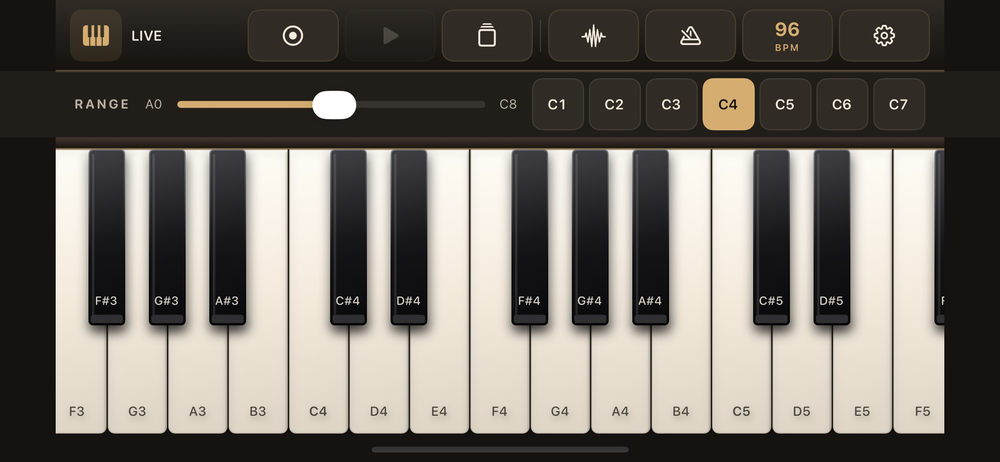

## 🎹 PianoFlow

A tactile iOS piano keyboard built with SwiftUI and AVAudioEngine. Play the full 88-key A0–C8 range, practice with highlighted notes, connect a MIDI keyboard, and save or export your performances.



### 📲 Download on the App Store

- iOS: [PianoFlow on the App Store](https://apps.apple.com/us/app/pianoflow-keyboard/id6752531110)

### ✨ Features
- **🎹 88-key keyboard**: The acoustic piano range, A0 through C8, with independent finger tracking for chords and glissandos
- **🧭 Range navigation**: Octave shortcuts and a range slider keep navigation separate from the playing surface
- **⚙️ Customizable Settings**: Adjustable key width, key labels, piano volume, and haptic feedback
- **🎵 Expressive playing**: SoundFont-backed piano audio, balanced note release, sustain, and a live chord readout
- **⏱️ Guided practice**: Scales, arpeggios, chords, melodies, and a two-hand arrangement with highlighted keys, a daily goal, and local progress
- **🥁 Rhythm coach**: A synchronized count-in and click, note onset feedback, missed-note scoring, and optional gradual tempo increases after a successful pass
- **🎼 Sheet music & hands**: Following treble/bass staves with rests, accidentals, and ties; practice left, right, or both hands
- **📂 MIDI song import**: Import Standard MIDI files from Files, choose which tracks to include, assign hands, and save songs for guided practice
- **🎛️ MIDI input**: USB and Bluetooth MIDI keyboards with velocity and sustain pedal support
- **⏺️ Performance library**: Record notes, velocity, and sustain; rename, trim copies, loop a section, adjust playback speed, and share MIDI, WAV, or M4A files
- **🔊 PianoFlow Premium**: A one-time purchase removes ads and adds Warm Studio and Bright Hall sound profiles
- **📱 Instrument design**: Responsive ivory and ebony keys with a compact dark control panel
- **🏗️ MVVM Architecture**: Clean separation with `@Observable` view models and Swift concurrency

### 🏗️ Architecture
- **📋 Pattern**: MVVM with Swift concurrency
- **🎛️ ViewModel**: `@Observable` and `@MainActor`-scoped for UI-safe state management
- **🔊 Audio**: `AVAudioEngine` + `AVAudioUnitSampler` for SoundFont playback
- **💾 State Management**: User preferences stored with `@AppStorage`

**🔄 Data Flow**:
- 📱 `PianoView` renders the scrollable keyboard and handles user interactions
- 🎚️ `PianoViewModel` manages key state, scroll position, and audio playback
- 🔊 `AudioEngine` handles the audio session, SoundFont, EQ, and reverb, while `MetronomeService` produces the click track
- 💾 `PerformanceStudio` saves note events locally; `RecordingEditor`, `MIDIExporter`, and `AudioExporter` provide editing and sharing
- 🎼 `PracticeSession` tracks physical note events and daily progress; recorded playback does not count toward practice
- 📂 `MIDIFileImporter` validates Standard MIDI files; `ImportedSongLibrary` saves editable track assignments locally
- 🎼 `ScoreNotation` indexes and spells the visible score window; `PracticeScoreView` draws the music with native vector graphics
- 🎛️ `MIDIInputService` copies CoreMIDI callback data before returning and combines held keys from multiple devices
- 🛍️ `PremiumStore` grants access only from verified StoreKit transactions
- ⚙️ `SettingsView` provides customization options with persistent storage

### 🛠️ Requirements
- 💻 Xcode 16 or later
- 📱 iOS 17.6 or later
- 🖥️ macOS Sonoma or later for development

### 🚀 Getting Started
1. 📥 Clone the repository
```bash
git clone https://github.com/banghuazhao/PianoFlow.git
cd PianoFlow
```
2. 🔧 Open the project in Xcode
```bash
open Piano.xcodeproj
```
3. ▶️ Select the `Piano` scheme and a simulator or device, then Run.

**📝 Note**: If you replace the SoundFont, put your `.sf2` file in `Piano/Sound/` and update the load call if needed.

### 📁 Project Structure
```text
Piano/
  App/                 # 🚀 App entry point (`PianoApp.swift`)
  Sound/               # 🎵 SoundFont file (`Piano.sf2`)
  Assets.xcassets/     # 🎨 App icons and colors
  Config/              # ⚙️ Build configurations
  Model/               # 📋 Piano notes, keys, and recorded takes
  Service/             # 🔊 Sampler, metronome, recording, MIDI export, chord detection
  View/                # 📱 Keyboard, instrument controls, library, and settings
  ViewModel/           # 🎛️ `PianoViewModel` with @Observable
```

### 🎼 Usage
- **🎹 Playing Notes**: Touch multiple keys for chords, or move a finger across keys for a glissando. The keyboard stays fixed while playing.
- **🧭 Navigation**: 
  - Use octave buttons (C1–C7) to jump across the full A0–C8 range
  - Drag the range slider for fine control
- **⏺️ Record and replay**: Tap Record, play, then tap Stop. Play replays the latest take; Takes opens saved performances. Tools offers naming, speed, loops, trimmed copies, and WAV/M4A export.
- **🎼 Guided practice**: Open Practice (or More → Guided practice on compact screens), choose an exercise, then select hands and a mode. At your pace waits for correct notes; Rhythm coach adds a count-in and grades note onset timing. Release repeated notes before replaying them. Note lengths are displayed but are not graded.
- **🥁 Tempo progression**: Choose a start tempo, goal tempo, and optional +5/+10 BPM increment. A pass with at least 80% pitch and timing accuracy offers the next tempo. Tap it to begin a fresh pass. Pause/resume uses a fresh count-in; audio interruptions also pause practice.
- **📂 Your MIDI songs**: Choose Import in Practice and select a `.mid` or `.midi` file. Include the parts you want, and assign each to Left, Right, or Split at C4. Assignments, renamed titles, and songs persist on this device. Deleting a song leaves the original MIDI file intact.
- **🎼 Sheet music**: The score follows the current notes. Practice options can hide the score to reveal the keyboard range navigator. Imported rhythms are simplified to sixteenth-note spelling for display; rhythm grading uses the original MIDI onset times. MIDI does not encode an engraved score, so enharmonic spelling and dense arrangements may be simplified.
- **🎛️ MIDI keyboard**: Enable keyboard input in Settings. Plug in a USB MIDI keyboard, or choose Connect Bluetooth MIDI to use Apple's native pairing browser.
- **🎛️ Sustain and metronome**: Toggle them on the control panel. Tap the BPM display to adjust tempo, beats per bar, and click volume.
- **⚙️ Settings**: Tap the gear icon to access:
  - Key width adjustment (30–90 points)
  - Show/hide key names on keys
  - Toggle haptic feedback
  - Octave-specific key name display options
  - Piano volume
  - Piano sound profiles and the one-time Premium upgrade
- **🎨 Customization**: Replace `Piano.sf2` with a licensed SoundFont to change the piano sound.

### Verification and Premium setup

Run `bash Scripts/check-features.sh` to check rhythm scoring, practice progress, MIDI input and file import, score notation, recording boundaries, playback, and file export models. Build the `Piano` scheme for normal development. Use its local StoreKit configuration to test Premium; see [Premium setup](Docs/PremiumSetup.md) for product configuration and purchase testing.

MIDI import supports Standard MIDI format 0 and 1 with PPQN timing. Percussion and notes outside A0–C8 are skipped and reported. Format 2 and SMPTE timing receive a clear unsupported-file error. Practice uses one selected tempo and meter; files with tempo or meter changes disclose that simplification. The importer limits file size, note count, song duration, and library storage to keep malformed or unusually large files from overwhelming the instrument.

Warm Studio and Bright Hall apply EQ and reverb to the bundled piano samples. WAV/M4A export renders one selected pass at the chosen speed and preserves the sound profile; a playback loop does not create an endless export.

### 🤝 Contributing
- 📝 Open an issue or pull request on GitHub
- 🏗️ Follow MVVM architecture with `@Observable` view models and Swift concurrency
- 🔧 Prefer small, well-scoped changes
- 📚 Maintain consistent code style and documentation

### 📄 License
See [LICENSE](LICENSE).

### 🙏 Acknowledgements
- 🛠️ Built with SwiftUI and AVFoundation
- 🎵 Uses a bundled SoundFont file (`Piano.sf2`). Replace with your own if licensing requires.
- ©️ Copyright Apps Bay Limited. All rights reserved.

### 🔗 Links
- 📦 Repository: `https://github.com/banghuazhao/PianoFlow`
- 🛍️ App Store: `https://apps.apple.com/us/app/pianoflow-keyboard/id6752531110`
